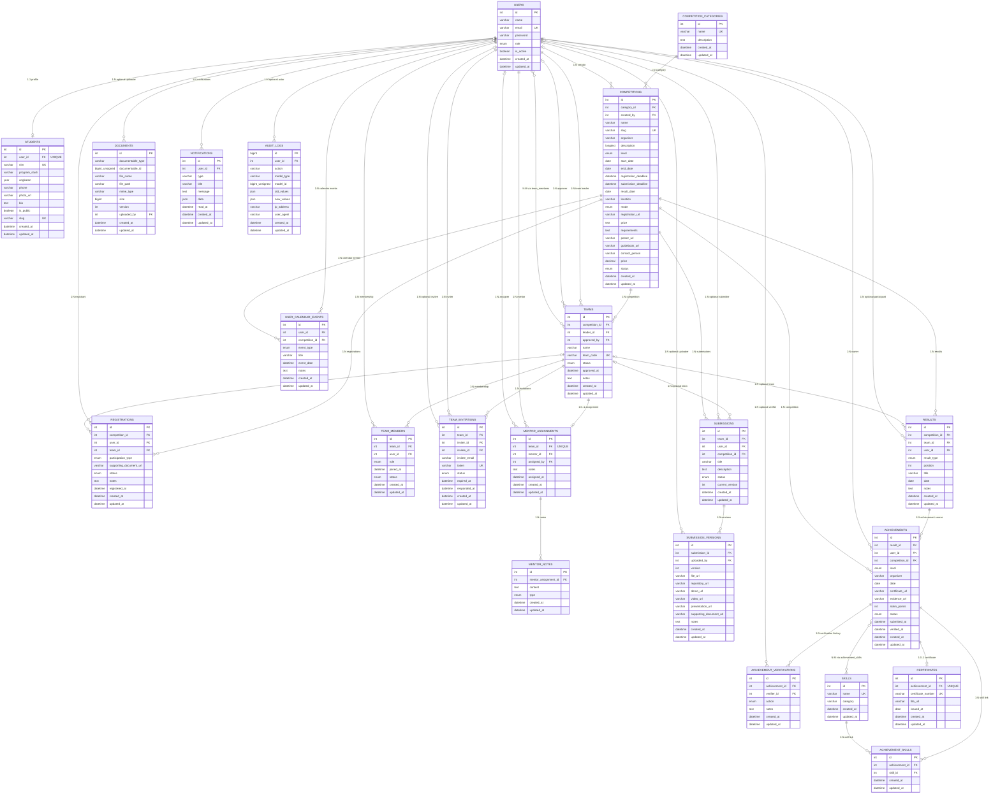

# SCAP — Student Competition & Achievement Platform

SCAP adalah monorepo aplikasi pengelolaan kompetisi dan prestasi mahasiswa.
Backend menggunakan Express 4, Sequelize 6, dan MySQL 8; frontend menggunakan
React 18, Vite, Tailwind CSS, React Router 6, Axios, dan TanStack Query.

## Prasyarat

- Node.js 20+
- MySQL 8 (dapat dijalankan melalui Laragon)
- npm
- Docker Compose (opsional; hanya untuk menjalankan frontend/backend)

## Database Setup

1. Pastikan Laragon/MySQL 8 berjalan, lalu buat database `scap_db` melalui
   phpMyAdmin (`http://localhost/phpmyadmin`) dengan collation
   `utf8mb4_unicode_ci`.
2. Salin `backend/.env.example` menjadi `backend/.env`, lalu pastikan
   konfigurasi `DB_HOST`, `DB_PORT`, `DB_USER`, `DB_PASS`, dan `DB_NAME` sesuai.
3. Instal dependencies dan siapkan database dari folder backend:

   ```powershell
   cd backend
   npm install
   npm run db:migrate
   npm run db:seed
   npm run db:verify
   ```

   Kredensial testing: `superadmin@scap.test`, `pka@scap.test`, dan akun
   mahasiswa Faker (`@scap.test`); password semua akun `Password123!`.
   Untuk menghapus dan membangun ulang database beserta data seed secara
   destruktif, jalankan `npm run db:reset` setelah menghentikan proses yang
   sedang memakai database.

## Menjalankan dengan Laragon

1. Jalankan MySQL dari Laragon dan buat database `scap_db` dengan collation
   `utf8mb4_unicode_ci`.
2. Salin `backend/.env.example` menjadi `backend/.env`, lalu sesuaikan
   `DB_HOST`, `DB_PORT`, `DB_USER`, `DB_PASS`, dan `DB_NAME`. Isi nilai acak
   yang kuat untuk secret JWT sebelum menggunakan aplikasi di luar development.
3. Instal dependensi dan siapkan database:

   ```powershell
   cd backend
   npm install
   npm run db:migrate
   npm run db:seed
   npm run dev
   ```

   API berjalan di `http://localhost:5000`; health check tersedia di
   `http://localhost:5000/api/health`.
   Untuk reset database beserta data secara penuh, jalankan
   `npm run db:reset` setelah menghentikan proses yang sedang memakai database.
4. Pada terminal lain, jalankan frontend:

   ```powershell
   cd frontend
   npm install
   npm run dev
   ```

   Buka `http://localhost:5173`.

Jalankan test backend dan frontend masing-masing dari folder proyeknya dengan
`npm test`.

## Autentikasi dan RBAC

Backend menyediakan `POST /api/auth/register`, `POST /api/auth/login`,
`POST /api/auth/refresh`, `POST /api/auth/logout`, `GET /api/auth/me`, dan
endpoint demo role `GET /api/auth/ping/mahasiswa` serta
`GET /api/auth/ping/admin`. Kirim access token sebagai
`Authorization: Bearer <accessToken>`. Access token berlaku 15 menit; refresh
token berlaku 7 hari dan dicabut ketika logout. Batas permintaan auth adalah
10 request per menit per IP.

Contoh login akun seeder:

```powershell
curl.exe -X POST http://localhost:5000/api/auth/login `
  -H "Content-Type: application/json" `
  -d "{\"email\":\"superadmin@scap.test\",\"password\":\"Password123!\"}"
```

Jalankan test backend dari folder `backend` dengan `npm test`. Test auth
menggunakan model in-memory agar dapat dijalankan tanpa koneksi MySQL; untuk
demonstrasi data persisten, jalankan migration dan seeder ke `scap_db` terlebih
dahulu.

Seeder membuat akun demo berikut; seluruh akun memakai password
`Password123!`:

| Peran | Email |
|---|---|
| Super admin | `superadmin@scap.test` |
| Admin PKA | `pka@scap.test` |
| Verifier | `verifier1@scap.test`, `verifier2@scap.test` |
| Pimpinan | `pimpinan@scap.test` |
| Prodi | `prodi@scap.test` |
| Mahasiswa | `mahasiswa01_scap72@scap.test` (dan 19 akun Faker lainnya) |

Akun ini hanya untuk development lokal. Ganti atau hapus sebelum deployment.

## Manajemen Kompetisi

Admin `admin_pka` dan `super_admin` dapat mengelola kategori di
`/api/competition-categories` serta kompetisi di `/api/competitions`.
Dashboard admin memakai `GET /api/competitions/stats` untuk total kompetisi
dan ringkasan status.
Endpoint publik discovery tersedia di `/api/public/competitions` dan hanya
menampilkan kompetisi selain draft. Semua route admin memerlukan
`Authorization: Bearer <accessToken>`. Poster JPG/PNG/WEBP (maks. 2 MB) dan
panduan PDF (maks. 10 MB) disimpan di `backend/uploads/competitions/` dan
diakses melalui `/uploads/competitions/<nama-file>`. Audit perubahan
kompetisi dan kategori dicatat di `audit_logs`; tidak ada migration baru.

Jalankan `npm test` dari `backend` untuk menjalankan test auth dan kompetisi.
Test endpoint menggunakan model in-memory; jalankan migration dan seeder untuk
menyimpan data demonstrasi ke MySQL.

## Menjalankan backend/frontend dengan Docker Compose

Pastikan MySQL Laragon berjalan dan `backend/.env` sudah tersedia. Compose
menjalankan hanya backend dan frontend; backend mengakses host MySQL melalui
`host.docker.internal`. Jalankan dari root:

```powershell
docker compose up --build
```

Jalankan migration dan seeder dari terminal kedua:

```powershell
docker compose exec backend npm run db:migrate
docker compose exec backend npm run db:seed
```

## Struktur utama

```text
backend/
  migrations/                 Sequelize migrations
  src/
    config/                   env, Sequelize connection, CLI config
    scripts/                  verifikasi database
    seeders/                  16 ordered, idempotent development seeders
    controllers/ middlewares/ routes/ services/ validators/ utils/ jobs/
    models/                    seluruh model dan associations
    app.js server.js
  tests/
frontend/
  src/
    api/ components/ contexts/ hooks/ routes/ utils/
    pages/auth/ pages/student/ pages/admin/ pages/public/
```

## Verifikasi database

Jalankan migration dan seeder, lalu cek jumlah data serta query relasi:

```powershell
cd backend
npm run db:migrate
npm run db:seed
npm run db:verify
```

`db:verify` menampilkan jumlah baris setiap tabel dan lima query sanity check.
Tabel `registrations`, `documents`, dan `user_calendar_events` dapat berjumlah
nol karena belum termasuk data pada 16 seeder; jumlah nol ditampilkan sebagai
peringatan, bukan dianggap kegagalan koneksi.

### Pemeriksaan manual melalui phpMyAdmin

1. Pilih database `scap_db` dan buka tab **Structure**. Pastikan tabel memakai
   nama plural snake_case, termasuk `user_calendar_events` dan
   `achievement_verifications`.
2. Buka tabel, lalu tab **Structure** atau **Relation view**. Pastikan kolom
   `*_id` yang merupakan foreign key mengarah ke tabel dan kolom `id` yang
   benar. Periksa aksi `ON DELETE` sesuai skema (termasuk `SET NULL` pada
   uploader/verifier/audit actor dan `CASCADE` pada relasi wajib).
3. Pada **Structure**, cek tipe `ENUM` dan daftar nilainya untuk role,
   competition level/status/mode, team status, submission status, result type,
   achievement level/status, verification action, mentor note type, dan
   calendar event type. Contoh nilai penting: `users.role` (`super_admin`,
   `admin_pka`, `mahasiswa`, `verifier`, `pimpinan`, `prodi`);
   `results.result_type` (`participation`, `finalist`, `winner`);
   `achievements.status` (`draft`, `submitted`, `under_verification`,
   `revision_required`, `verified`, `rejected`); dan
   `user_calendar_events.event_type` (`registration`, `submission`, `result`,
   `custom`).
4. Pada **Structure → Indexes** (atau **Relation view**), pastikan indeks
   kompetisi, dokumen polymorphic, notifikasi, audit log, pasangan unik
   achievement-skill dan user-calendar-event, serta unique key lain terlihat.
5. Buka tab **SQL** untuk menjalankan query verifikasi atau periksa jumlah baris
   tiap tabel dari tab **Browse**.

## ERD database



`DOCUMENTS` memakai polymorphic key (`documentable_type`, `documentable_id`),
sehingga target dokumennya tidak memiliki foreign key database. `SUBMISSIONS`
memiliki `team_id` dan `user_id` nullable; validasi model mengharuskan salah
satunya terisi. Field `created_at` dan `updated_at` bertipe `DATETIME` pada
seluruh tabel.

## Ringkasan tabel dan data seeder

| Tabel | Deskripsi | Relasi Utama | Jumlah Seeder |
|---|---|---|---:|
| `users` | Akun dan peran pengguna | Profil mahasiswa, tim, prestasi, aktivitas | 26 |
| `students` | Profil mahasiswa | 1:1 `users` | 20 |
| `competition_categories` | Kategori kompetisi | 1:N `competitions` | 7 |
| `competitions` | Informasi dan jadwal kompetisi | Kategori, tim, registrasi, hasil | 12 |
| `skills` | Katalog keterampilan | N:M prestasi | 15 |
| `teams` | Tim peserta | Kompetisi, pemimpin, anggota | 6 |
| `team_members` | Penghubung tim dan anggota | N:M `teams`–`users` | 19 |
| `registrations` | Registrasi mahasiswa/tim | Kompetisi, pengguna, tim | 0 |
| `team_invitations` | Undangan bergabung ke tim | Tim, inviter, invitee | 5 |
| `mentor_assignments` | Mentor yang ditugaskan ke tim | Tim, mentor, assigner | 2 |
| `mentor_notes` | Catatan pendampingan | 1:N `mentor_assignments` | 6 |
| `submissions` | Karya untuk kompetisi | Tim/pengguna dan kompetisi | 3 |
| `submission_versions` | Riwayat versi submission | Submission dan uploader | 3 |
| `results` | Hasil kompetisi | Kompetisi, tim atau pengguna | 4 |
| `achievements` | Prestasi mahasiswa dan SKKM | Hasil, pemilik, kompetisi | 5 |
| `achievement_verifications` | Riwayat verifikasi prestasi | Prestasi dan verifier | 4 |
| `achievement_skills` | Penghubung prestasi dan skill | N:M `achievements`–`skills` | 6 |
| `certificates` | Sertifikat prestasi | 1:0..1 `achievements` | 2 |
| `documents` | Metadata file dengan target polymorphic | Uploader; target via type/id | 0 |
| `notifications` | Notifikasi pengguna | N:1 `users` | 20 |
| `audit_logs` | Log aktivitas sistem | N:1 pengguna opsional | 30 |
| `user_calendar_events` | Agenda kompetisi per pengguna | Pengguna dan kompetisi | 0 |

## Catatan awal

- API awal menyediakan health check; modul bisnis dan autentikasi belum
  diimplementasikan.
- `frontend/src/api/axios.js` menggunakan base URL API localhost dan mengambil
  access token dari `localStorage` untuk header Bearer.
- Migration membuat skema 22 tabel. Periksa kebijakan retensi data sebelum
  memakai penghapusan cascade di produksi.
