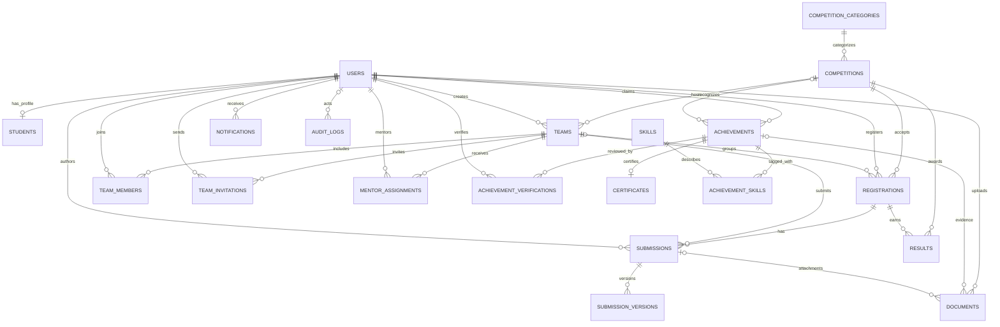

# SCAP — Student Competition & Achievement Platform

SCAP adalah monorepo aplikasi pengelolaan kompetisi dan prestasi mahasiswa.
Backend menggunakan Express 4, Sequelize 6, dan MySQL 8; frontend menggunakan
React 18, Vite, Tailwind CSS, React Router 6, Axios, dan TanStack Query.

## Prasyarat

- Node.js 20+
- MySQL 8 (dapat dijalankan melalui Laragon)
- npm
- Docker Compose (opsional; hanya untuk menjalankan frontend/backend)

## Menjalankan dengan Laragon

1. Jalankan MySQL dari Laragon dan buat database `scap` dengan collation
   `utf8mb4_unicode_ci`.
2. Salin `backend/.env.example` menjadi `backend/.env`, lalu sesuaikan
   `DB_HOST`, `DB_PORT`, `DB_USER`, `DB_PASS`, dan `DB_NAME`. Isi nilai acak
   yang kuat untuk secret JWT sebelum menggunakan aplikasi di luar development.
3. Instal dependensi dan siapkan database:

   ```powershell
   cd backend
   npm install
   npm run db:migrate
   npm run db:seed
   npm run dev
   ```

   API berjalan di `http://localhost:5000`; health check tersedia di
   `http://localhost:5000/api/health`.
4. Pada terminal lain, jalankan frontend:

   ```powershell
   cd frontend
   npm install
   npm run dev
   ```

   Buka `http://localhost:5173`.

Jalankan test backend dan frontend masing-masing dari folder proyeknya dengan
`npm test`.

Seeder membuat akun demo berikut; seluruh akun memakai password
`ScapDemo2026!`:

| Peran | Email |
|---|---|
| Super admin | `superadmin@scap.local` |
| Admin PKA | `admin@scap.local` |
| Mahasiswa | `ayu@scap.local` |
| Mahasiswa | `bima@scap.local` |
| Mahasiswa | `citra@scap.local` |

Akun ini hanya untuk development lokal. Ganti atau hapus sebelum deployment.

## Menjalankan backend/frontend dengan Docker Compose

Pastikan MySQL Laragon berjalan dan `backend/.env` sudah tersedia. Compose
menjalankan hanya backend dan frontend; backend mengakses host MySQL melalui
`host.docker.internal`. Jalankan dari root:

```powershell
docker compose up --build
```

Jalankan migration dan seeder dari terminal kedua:

```powershell
docker compose exec backend npm run db:migrate
docker compose exec backend npm run db:seed
```

## Struktur utama

```text
backend/
  migrations/                 Sequelize migrations
  seeders/                    data demo
  src/
    config/                   env, Sequelize connection, CLI config
    controllers/ middlewares/ routes/ services/ validators/ utils/ jobs/
    models/                    seluruh model dan associations
    app.js server.js
  tests/
frontend/
  src/
    api/ components/ contexts/ hooks/ routes/ utils/
    pages/auth/ pages/student/ pages/admin/ pages/public/
```

## ERD MVP



## Catatan awal

- API awal menyediakan health check; modul bisnis dan autentikasi belum
  diimplementasikan.
- `frontend/src/api/axios.js` menggunakan base URL API localhost dan mengambil
  access token dari `localStorage` untuk header Bearer.
- Migration membuat seluruh 20 tabel MVP dengan foreign key cascade. Periksa
  kebijakan retensi data sebelum memakai penghapusan cascade di produksi.
